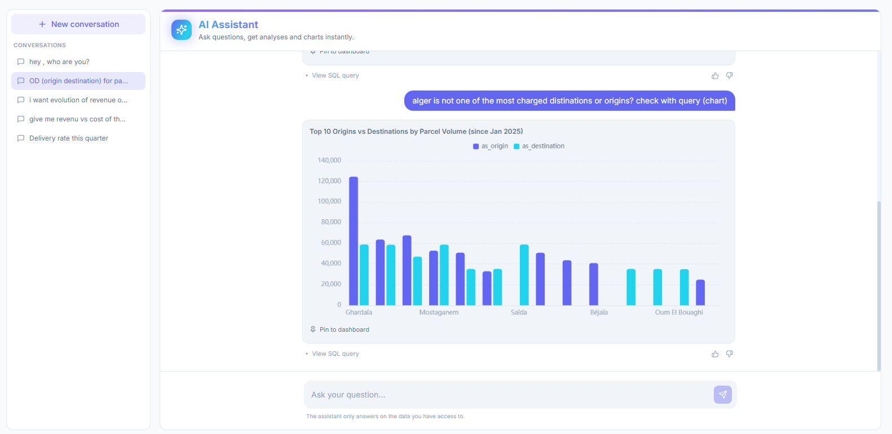
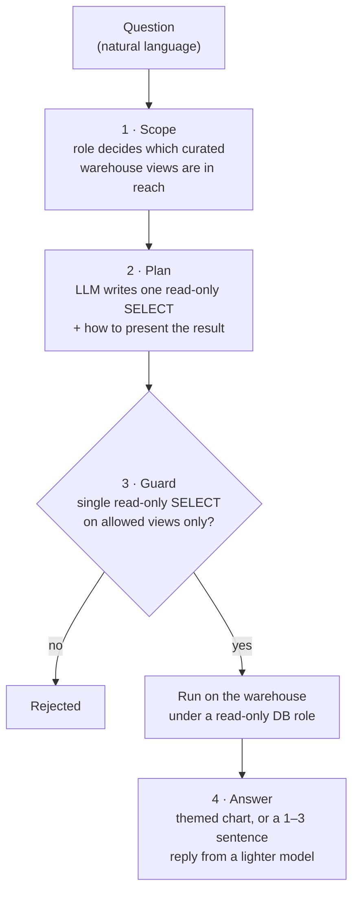
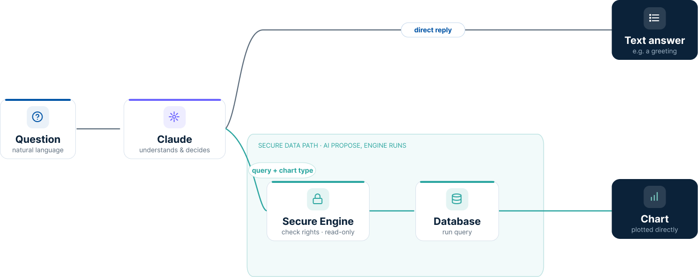

# AI assistant

Every dashboard answers a question the manager already knows to ask: they navigate to the right
page and read the figures. LOGIQ adds a complementary way in, a built-in **conversational
assistant** that turns *navigate to find* into *ask to receive*.

It lives in a chat drawer available on every dashboard page. A manager asks a question in plain
language (French or English) and gets the answer in place: a short sentence with the figures, a
chart, or both.

<figure markdown="span">
  { loading=lazy }
  <figcaption>The assistant answering a natural-language question with a chart (synthetic test data).</figcaption>
</figure>

## How it works

The assistant is built on a hosted **Large Language Model**. The model is used strictly to
**translate a question into a query**. It is never the source of the figures.

1. **Scope** — the user's role fixes which dashboards, and therefore which curated warehouse
   views, are in reach. Only those are shown to the model.
2. **Plan** — the model turns the question into a single read-only `SELECT` over the allowed
   views, plus a specification of how to present the result.
3. **Guard & run** — a deterministic check rejects any query that is not a single read-only
   `SELECT`, or that touches a table outside the allowed set. Accepted queries run under a
   dedicated **read-only database role**.
4. **Answer** — the result is rendered as a themed chart, or narrated into a one- to
   three-sentence reply by a lighter, cheaper model.

<figure markdown="span">
  { loading=lazy .on-white }
  <figcaption>The model proposes; a secure engine checks rights and runs the query read-only.</figcaption>
</figure>

## Why it can be trusted

!!! success "Same access rules as the rest of the platform"
    The assistant honours the same **role-based access control**, enforced on the server. A
    transport-only manager who asks about parcels is politely refused rather than shown data
    outside their remit.

!!! success "Auditable answers"
    Every figure is read from the warehouse, never generated by the model. Each question,
    generated query and outcome is **logged**.
