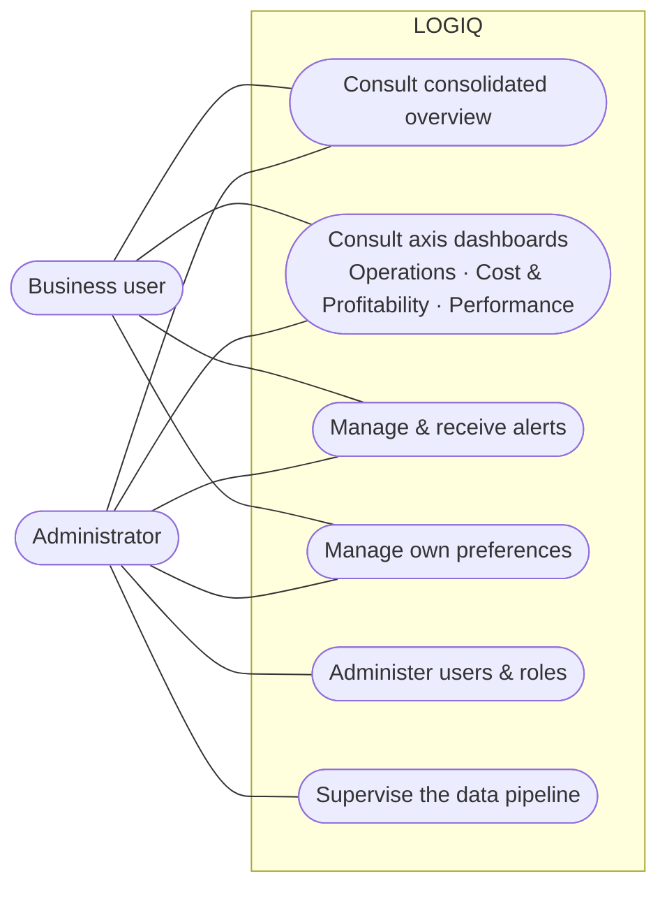
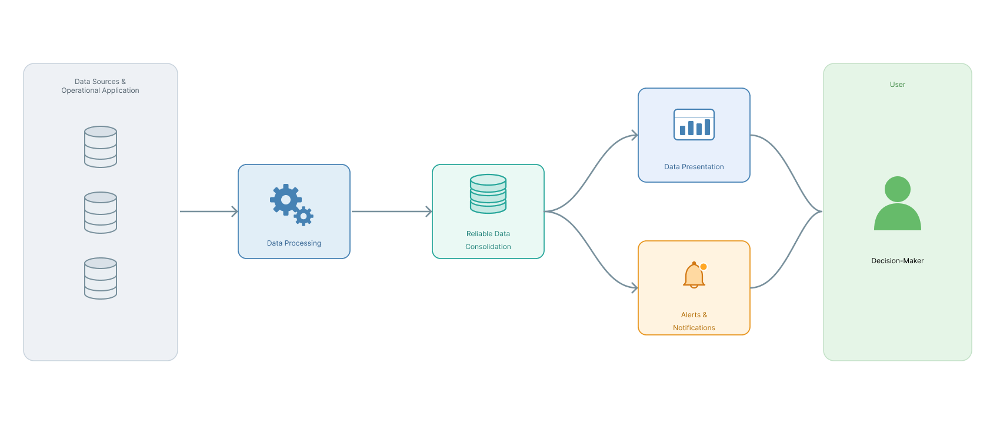
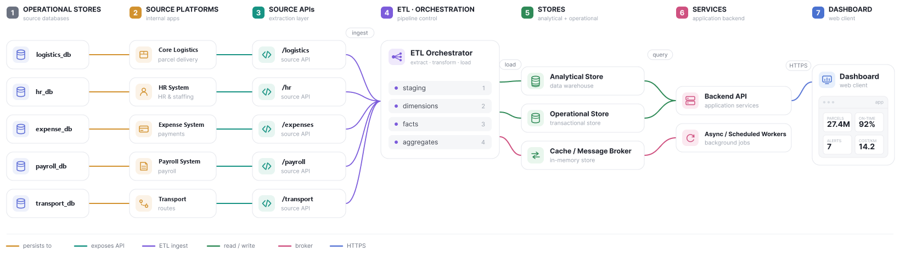
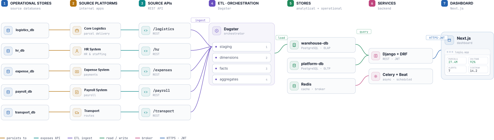
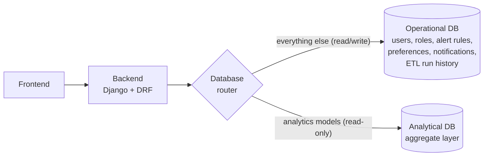
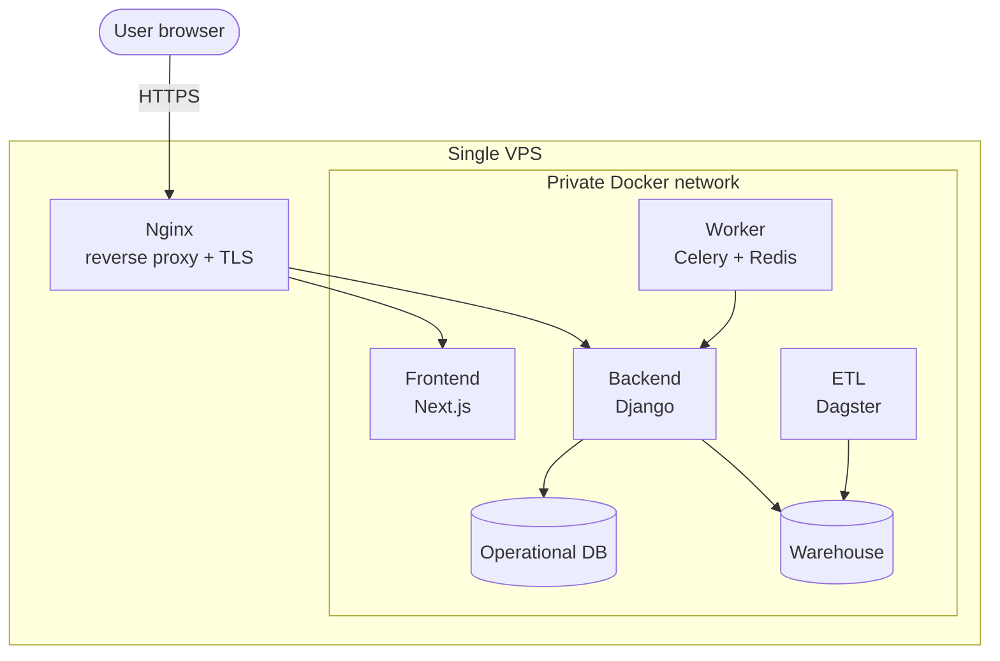

# Architecture

This page moves from **what** LOGIQ must do (its specifications) to **how** it is structured: the
functional value chain, the global architecture, the technology stack, security and deployment.

## Actors and roles

LOGIQ is used by the company's own decision-makers, never by the public. Users do not
self-register. They are **imported from the HR system** and activated by an administrator, who
assigns each one a **role**. The role decides which views the user may open.

| Default role | What they consult |
|---|---|
| General management (*Direction Générale*) | Overview, Parcel Delivery (3 views), Dedicated Transport (3 views) |
| Parcel & cost-control manager | Overview, Parcel Delivery (3 views) |
| Routes manager | Overview (Route Analysis is future work) |
| Transport manager | Overview, Dedicated Transport (3 views) |
| Administrator | Every view, plus user activation, role assignment and pipeline history |

Permissions are configurable at view level, so the administrator can create new roles as the
organisation evolves, without touching the system.

## Functional specifications

| Family | ID | Specification |
|---|---|---|
| Multi-axis decision consultation | FS01 | Consult each axis along its three views |
| | FS02 | Show a consolidated overview of both axes |
| Proactive monitoring | FS03 | Define threshold rules on sensitive indicators |
| | FS04 | Alert automatically, through the preferred channel, when a metric drifts |
| Role-appropriate access & personalisation | FS05 | Show each decision-maker only the sections suited to their role |
| | FS06 | Save personal filters and view preferences |
| | FS07 | Customise alert delivery channels |
| | FS08 | Switch between dark and light themes |
| | FS09 | Switch the language between Arabic, French and English |
| Administration | FS10 | Activate HR-imported users |
| | FS11 | Assign and adjust roles |
| | FS12 | Supervise the data-refresh pipeline and its run history |

## Functional architecture

Read left to right, LOGIQ is a one-directional **value chain**. Data leaves the operational
systems, is processed and consolidated into one reliable base, and then forks into two
decision-ready outputs: **presentation** (answering questions when they are asked) and **alerts**
(answering them before they are asked).

<figure markdown="span">
  { loading=lazy .on-white }
  <figcaption>Functional architecture: from operational sources to decision-ready outputs.</figcaption>
</figure>

Two further responsibilities cut across the whole chain. **Access & personalisation** filters
every interaction by role and remembers preferences. **Administration** governs users, roles and
the processing pipeline.

## Technical specifications

The non-functional requirements follow the product-quality characteristics of ISO/IEC 25010.

??? abstract "The 19 technical specifications (TS01–TS19)"

    | Characteristic | ID | Specification |
    |---|---|---|
    | Performance efficiency | TS01 | Analytical views return within seconds, not minutes, over the full national history |
    | | TS02 | Response time stays bounded as data grows, by reading a pre-computed aggregate layer |
    | | TS03 | Analytical workloads are isolated from operational ones |
    | Capacity & scalability | TS04 | Sized for tens of millions of parcel-status events |
    | | TS05 | Refreshed automatically and incrementally, never fully reloaded |
    | Reliability | TS06 | Figures are consistent across every view |
    | | TS07 | The refresh is idempotent and recoverable |
    | | TS08 | Graceful degradation when the analytical store is briefly unavailable |
    | Security | TS09 | Every view gated by RBAC; accounts provisioned from HR, never self-registered |
    | | TS10 | The two financial perimeters are kept strictly separate |
    | | TS11 | Stateless authentication and encrypted transport |
    | Usability | TS12 | Visual-first, readable by non-specialists |
    | | TS13 | Every KPI has a chart plus an on-demand data-table view |
    | | TS14 | Consistent across both axes and their three views |
    | Maintainability | TS15 | Loosely coupled modules on open, non-proprietary foundations |
    | | TS16 | Operational and analytical concerns cleanly separated |
    | Compatibility & portability | TS17 | Source integration depends only on each system's API contract |
    | | TS18 | Accommodates the deferred Route Analysis axis without restructuring |
    | | TS19 | Reproducibly deployable on modest infrastructure |

Three characteristics drive the design: **performance and capacity** (the aggregate layer and the
analytical/operational split), **reliability** (layered, quality-gated, idempotent refresh) and
**security** (RBAC and separate financial perimeters).

## Global architecture

LOGIQ is built from five blocks: a **data warehouse**, an **automated ETL pipeline**, **analytical
dashboards**, **dynamic alerting**, and **role and account management** kept in step with the HR
system.

=== "Logical view"

    <figure markdown="span">
      { loading=lazy .on-white }
      <figcaption>End-to-end data flow, each block named by its role (source systems shown with generic names).</figcaption>
    </figure>

=== "Technical view"

    <figure markdown="span">
      { loading=lazy .on-white }
      <figcaption>The same flow with every block mapped to the technology that realises it.</figcaption>
    </figure>

The five source systems expose their data over REST APIs. A **Dagster** pipeline ingests them and
builds the warehouse in four layers. Results land in two **PostgreSQL** databases (analytical
and operational), with **Redis** as cache and message broker. A **Django + DRF** backend serves
the dashboard, while a **Celery** worker runs alerting off the request path. The **Next.js** web
client renders everything over HTTPS.

## Technology stack

The whole platform is built on **open-source, free software**. Each tool was chosen for stability,
performance at national scale, and existing mastery.

| Concern | Technology | Why |
|---|---|---|
| Languages | Python, SQL | Mature data ecosystem; set-based transformations in the database |
| Data & warehouse | PostgreSQL | One robust engine for the warehouse, the operational DB and the test sources |
| Orchestration | Dagster | Asset-oriented pipeline with built-in lineage and selective re-runs |
| Backend & API | Django (≥ 4.2), Django REST Framework | API, ORM, authentication and permissions |
| Background jobs | Celery, Redis 7 | Alert evaluation and notification fan-out off the request path |
| Frontend | Next.js, React, Tailwind CSS 3 | Type-safe, component-based single-page dashboard |
| Visualisation | ECharts, D3.js, Leaflet, Tremor | Statistical charts, custom diagrams, maps, KPI cards |
| Infrastructure | Docker, Docker Compose, Nginx, Let's Encrypt | Reproducible containers, reverse proxy, automatic TLS |
| Test apparatus *(not delivered)* | FastAPI, Faker | Simulated source systems and synthetic data |

## Two data planes

The backend connects to **two** PostgreSQL databases. A database router sends each query to the
right one, transparently to the application code.

Heavy analytical reads never disturb the running application, and each store can be tuned — and
can fail — independently.

## Security and conformity

LOGIQ handles commercially confidential figures (costs, margins, volumes) and personal data
(clients, employees). Security is therefore built into the design from the start, not added at
the end.

**Access control** rests on a governed user base (accounts mirrored from HR, activated by an
administrator) and **role-based access control** at view level:

| Role | Overview | Parcel | Transport | Admin |
|---|:---:|:---:|:---:|:---:|
| General management | :material-check: | :material-check: | :material-check: | — |
| Parcel & cost-control manager | :material-check: | :material-check: | — | — |
| Transport manager | :material-check: | — | :material-check: | — |
| Routes manager | :material-check: | — | — | — |
| Administrator | :material-check: | :material-check: | :material-check: | :material-check: |

Sessions use **stateless, revocable tokens**. Access follows **least privilege**, and the
analytical services are **read-only**, so no dashboard user can alter the data.

The design is aligned with **ISO/IEC 27001**, the client's information-security framework, and
with **Algerian Law 18-07** on personal-data protection:

| Obligation | How the design responds |
|---|---|
| Need-to-know access | RBAC over an HR-governed user base, least-privilege permissions |
| Data minimisation (Law 18-07) | Dashboards show aggregated indicators, not individual client records |
| Integrity of source data | Read-only layer: LOGIQ never writes back to the operational systems |
| Segregation of perimeters | Transport and parcel figures are never mixed |
| Security in transit | Everything is encrypted; only the public web entry point is exposed |
| Traceability | User activation, role changes and every pipeline run are recorded |

## Deployment

The whole platform is **containerised** and brought up with a single Docker Compose command.

- **Persistence:** both databases and the Dagster run history live on named volumes, so
  redeploying never loses data.
- **Network isolation:** a host firewall leaves only the web ports open. Databases, Redis, the
  orchestrator and the worker sit on a private Docker network.
- **TLS:** a multi-domain Let's Encrypt certificate, renewed automatically. Nginx also carries the
  event stream used for real-time notifications.
- **Hosting:** for testing and demonstration, the entire stack runs on **one modest VPS (2 vCPU,
  8 GB RAM, 100 GB disk, Ubuntu 24.04 LTS)**. The production deployment is to be provisioned by the
  company.
- **Automation:** the ETL runs on schedule, certificates renew themselves, and containers restart
  automatically on failure or reboot.
