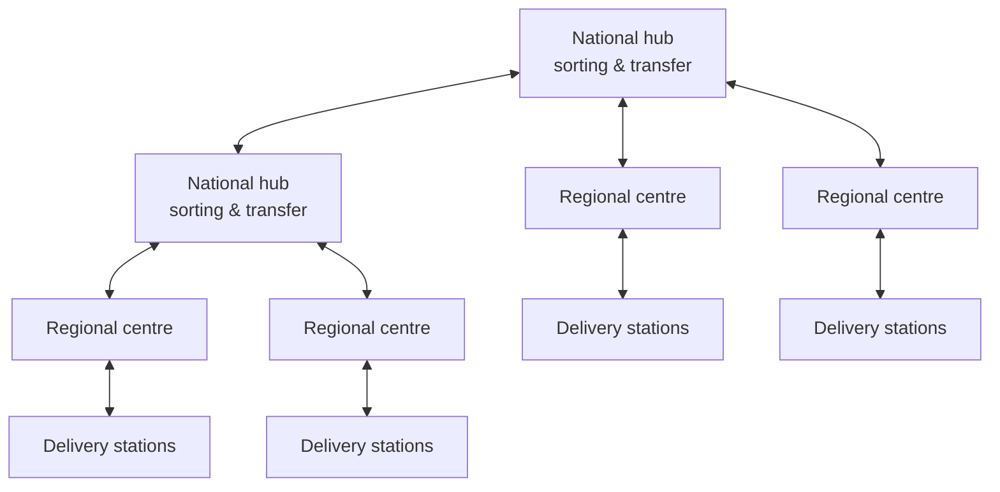
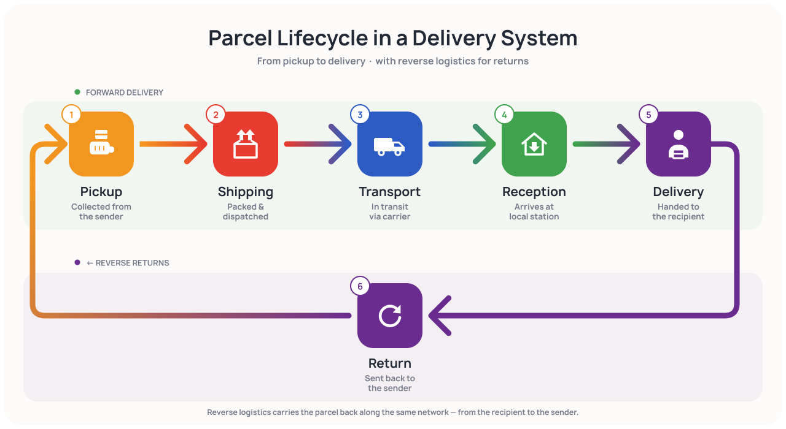
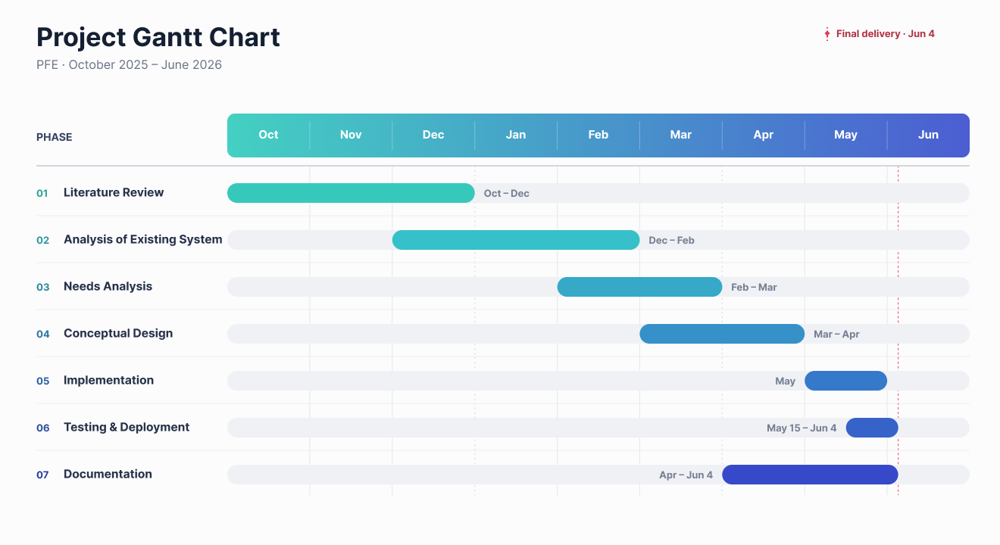

# Case study

Logistics operators generate huge volumes of data every day — parcels, trips, expenses,
payroll — yet many cannot turn it into decisions. This page sets the scene: who the project was
for, how the business works, what was wrong with the existing situation, and what the new system
had to achieve.

## Context

Algeria's e-commerce sector is growing fast. Registered e-commerce businesses have grown by about
**92 % a year since 2020**. Market revenue was about **USD 1.3 billion in 2024** and is projected
to exceed **USD 2 billion by 2029**. Delivery companies must therefore scale while keeping costs
under control.

The problem is rarely a lack of data. It is that the data is **fragmented**. Operational, HR,
expense and transport systems each run on their own data model, so decisions end up delayed,
duplicated or simply sub-optimal.

!!! question "The question behind the project"
    How can a unified, automated and scalable Business Intelligence architecture turn fragmented
    logistics data into a reliable foundation for proactive, data-driven decision-making across
    operations, cost and profitability, and performance?

## The organisations

<div class="partner-logos" markdown>


</div>

| Organisation | Role | Profile |
|---|---|---|
| **Ourquilane** | Host — designed and built the platform | Algerian software start-up based in Algiers. It modernises several sectors through digital platforms and decision-support tools, and runs a portfolio of business applications (HR, fleet, expense management, route planning). |
| **Yalidine El Djazair Services** | Client — whose data the platform analyses | Leader of express delivery in Algeria: B2B courier services, B2C e-commerce delivery and COD collection, with real-time parcel tracking. Certified ISO 9001, ISO 14001 and ISO 27001. |

### The logistics network

Parcels move through a **three-tier network**. At the top are four national hubs, covering the
north, the west, the east and the Great South. Below them sit regional sorting centres. At the
bottom, delivery stations handle the last mile.



Arrows are two-way: parcels move down for delivery and back up for transfers and returns. Each
delivery station covers a set of communes and assigns parcels to its drivers for the daily tours.

## Two business services

=== "Parcel express delivery (B2C)"

    The company's principal activity: last-mile delivery of parcels ordered online, from the
    merchant to the end customer.

    <figure markdown="span">
      { loading=lazy }
      <figcaption>The parcel lifecycle, with the reverse-logistics flow for undeliverable parcels.</figcaption>
    </figure>

    Behind these six stages, the operational system records a finer set of **statuses**. These
    statuses later drive the Operations indicators.

    | Phase | Statuses (system labels, in French) | What it captures |
    |---|---|---|
    | Creation | *En préparation*, *Prêt à expédier* | Registered and prepared by the merchant |
    | Outbound | *Expédié* | Picked up and dispatched into the network |
    | Transit | *Vers Wilaya*, *Transfert*, *Reçu à Wilaya* | Inter-hub and inter-wilaya movement |
    | Delivery preparation | *Centre*, *Prêt pour livreur*, *En attente du client* | At the destination station |
    | Delivery attempt | *Sorti en livraison*, *En alerte*, *Tentative échouée* | Out with the driver, at risk, or failed |
    | Delivered | *Livré* | Delivered, COD collected where applicable |
    | Return | *Échec livraison*, *Retourné au centre*, *Retour vers centre*, *Retour à retirer*, *Retourné au vendeur* | Routed back to the merchant |

    Each parcel also carries two commercial attributes:

    - **Delivery type** — *Home Delivery* (HD) to the customer's address, or *Stop Desk* (SD)
      pickup at a station.
    - **Price** — a delivered parcel and a returned parcel are billed at different rates. A
      *theoretical* tariff comes from the zone-based grid, while a *real* tariff is recomputed
      from the measured weight and volume. The gap between the two is a direct signal of cost
      and profitability.

=== "On-demand dedicated transport (B2B)"

    A client company commissions a **dedicated vehicle** for a specific trip. The process is
    organised around a single *request* rather than a parcel.

    ```mermaid
    flowchart LR
        A["Transport request"] --> B["Agreement"] --> C["Pickup"] --> D["Delivery"]
    ```

    Each request records the vehicle and its crew, the cargo (type, weight, volume, special
    handling) and the trip's routing and performance (distance, duration, delays, client
    rating).

    The **cost** of a trip is built up from several components: a fixed base, a distance
    supplement, pickup, delivery and handling costs, surcharges (night work, perishable goods,
    insurance), fuel and tolls. Comparing this cost with the amount invoiced is the basis of the
    profitability analysis.

## Operational applications

The day-to-day business runs on a suite of in-house applications, each managing one domain. User
accounts for all of them are managed centrally through the HR system.

| Application (generic name) | What it manages | Feeds LOGIQ? |
|---|---|:---:|
| Core logistics application | The overall logistics flow — physical, financial and operational | :material-check: |
| HR system | Personnel records, contracts, absences, organisation | :material-check: |
| Expense management system | Company-wide expenses, driver payments, reimbursements | :material-check: |
| Payroll system | Salaries and payslips | :material-check: |
| Dedicated transport module | B2B transport requests and their stops | :material-check: |
| Fleet management application | Vehicle maintenance, preventive planning, spare parts | — |
| Returns tracking application | QR-based tracking and storage of returned parcels | — |
| Asset & stock management tool | Warehouse stock, IT equipment, phone fleet | — |
| Customer-care application | Complaint reception, processing and follow-up | — |
| Stop-desk queue application | Counter queues and temporary parcel storage | — |

Each application does its own job well. The trouble is that they **do not talk to each other**,
so the same parcel, vehicle or expense ends up recorded in several places.

## Diagnosis

Seen from a decision-maker's chair, the existing situation shows one recurring pattern: the
information exists, but it is dispersed, inconsistent and hard to turn into a clear picture.

| # | Weakness | Consequence |
|---|---|---|
| 1 | Fragmented information | No single place to see the company as a whole |
| 2 | Duplicated, inconsistent records | The same question returns different answers |
| 3 | Doubtful reliability of figures | Time spent arguing over which number is right |
| 4 | Poor availability of information | Cross-cutting figures need slow manual reconciliation |
| 5 | Manual, time-consuming reporting | Spreadsheets rebuilt every time the question changes |
| 6 | Reactive management | Problems surface only in the next periodic report |
| 7 | No consolidated reading per activity | Neither axis can be followed along operations, cost and performance |
| 8 | Blurred financial perimeters | True profitability of each service is hard to establish |
| 9 | Limited historical perspective | Period comparisons and seasonality are hard to see |
| 10 | Dependence on individual knowledge | Insight is lost when a key person is unavailable |
| 11 | Decisions taken on intuition | Partial, late or unreliable information drives choices |

## Gathering the needs

| Technique | What it brought |
|---|---|
| Individual interviews | In-depth view of the returns and operations managers' daily difficulties |
| Group meeting | A project-review meeting at headquarters with the department heads |
| Process observation | An on-site visit to a sorting centre, following a parcel from pickup to return |
| Document analysis | Business processes, parcel statuses, application documentation, earlier theses |
| Application exploration | Hands-on use of the operational applications |

The needs converged on three families:

- **Informational** — one trustworthy source; each activity read along operations, cost and
  profitability, and performance; separate finances for the two services; enough history to
  compare periods.
- **Operational** — early warning when a key indicator drifts; information matched to each
  role; decisions grounded in evidence.
- **Quality** — reliable and responsive at national scale; simple enough for non-technical
  managers.

## Objectives

!!! abstract "General objective"
    Give management a single, reliable and consolidated decision-support system that gathers the
    scattered data into a faithful, timely view of the business.

1. **Consolidate the scattered data** into one coherent, continuously available source.
2. **Read each business axis in depth** through three views: Operations, Cost & Profitability,
   Performance.
3. **Keep the two financial perimeters separate**, so each axis is read on its own costs and
   revenues.
4. **Monitor proactively**: signal automatically when a key indicator drifts.
5. **Deliver the right information to the right decision-maker**, according to role.
6. **Found decisions on reliable data** for both day-to-day and strategic choices.

## Scope and priorities (MoSCoW)

| Priority | Scope item | What it delivers |
|---|---|---|
| **Must have** | On-demand dedicated transport (B2B) | Full decision support along the three views |
| **Should have** | Parcel express delivery (B2C) | The same three-view support for the parcel axis |
| **Could have** | Route analysis | Deferred: the data it requires was not available within the project scope |
| **Won't have (this time)** | Other domains (HR, payroll, fleet…) and any operational function | LOGIQ is a read-only decision-support layer |

??? info "Why is transport the *Must have* when parcels are the main activity?"
    The reason is analytical, not commercial. The parcel axis was already closely watched through
    real-time tracking. The cost, profitability and performance of dedicated transport, on the
    other hand, were the most opaque to management and the least served by any existing tool. So
    that is where consolidated decision support adds the most value first.

!!! tip "Two independent financial perimeters"
    The costs and revenues of the two services are **never mixed**. Each axis is read on its own
    perimeter, so one never inflates or masks the profitability of the other.

## Methodology and timeline

The work ran in seven phases between October 2025 and June 2026, planned and tracked in Notion.

<figure markdown="span">
  { loading=lazy }
  <figcaption>The seven phases of the project, from literature review to final delivery.</figcaption>
</figure>
