# Dashboards & alerting

The warehouse holds the data and the pipeline keeps it fresh. The **application platform** is
where decision-makers actually read it: a Next.js single-page application over a role-aware
Django REST API, which never touches a database directly.

!!! note "Synthetic data"
    All screenshots on this page show the platform populated with the **synthetic test dataset**.

## Navigation

The interface follows the way the business reasons: **two axes**, each read through **three
views**, plus a consolidated overview and supporting areas. Navigation is **filtered by role**,
so the menu itself reflects each user's permissions.

| Area | What it presents |
|---|---|
| Overview | The headline indicators of both axes side by side |
| Parcel Delivery | Operations · Cost & Profitability · Performance |
| On-Demand Dedicated Transport | The same three views, on a strictly separate financial perimeter |
| Alerts | Alerts raised or subscribed to, with status and history |
| Preferences | Saved filters, notification channels, theme and language |
| Administration | User activation, role assignment, pipeline supervision (administrators only) |

Users sign in with the credentials of the company HR system. There are no separate LOGIQ
passwords to manage.

<figure markdown="span">
  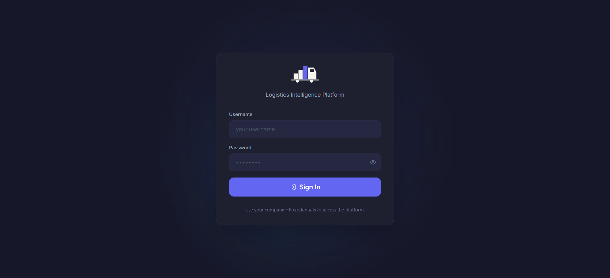{ loading=lazy }
  <figcaption>The sign-in screen.</figcaption>
</figure>

## The two axes, three views

Every page shows **five KPI cards** above **two rows of two charts**. A **global filter bar** is
shared across the page, so changing it re-synchronises every visualisation. A filter set can be
saved as a named **bookmark** for one-click return.

| Filter | Control | Values |
|---|---|---|
| Quick range | Pills | 7 d / 30 d / 90 d / year-to-date |
| Custom range | Date pickers | Any window within the available history |
| Type (parcel axis) | Dropdown | All / home delivery / stop-desk |
| Type (transport axis) | Dropdown | All / dedicated trip / courier / handling |

All monetary values are in DZD. Thresholds mentioned below are configurable user defaults, not
fixed limits.

=== "Transport · Operations"

    | KPI | Formula (pseudo) | Business value |
    |---|---|---|
    | Total requests | COUNT(*) over created date | Demand volume |
    | Completion rate % | completed / total × 100 | Fulfilment level |
    | Cancellation rate % | cancelled / total × 100 | Lost demand (watch above 10 %) |
    | Avg distance (km) | AVG(measured real distance) | Trip length / routing |
    | Avg stops / request | AVG(stops) | Logistical complexity |

    **Charts:** monthly volume (stacked bar) · service breakdown (donut) · origin–destination
    (heatmap) · distance category (bar).

    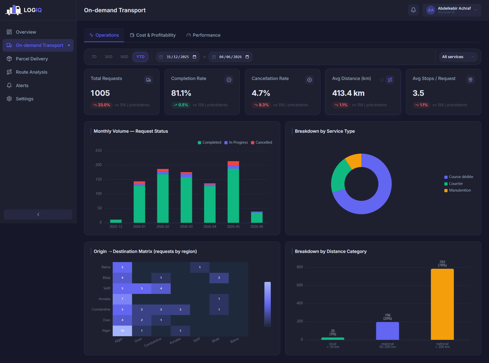{ loading=lazy }

=== "Transport · Cost & Profitability"

    | KPI | Formula (pseudo) | Business value |
    |---|---|---|
    | Total revenue | SUM(amount invoiced) | Billed revenue |
    | Total cost | SUM(8 cost components) | Cost build-up per trip |
    | Gross margin | revenue − cost | Absolute profit |
    | Margin % | margin / revenue × 100 | Profitability (target above 20 %) |
    | Cost / km | cost / distance | Unit economics |

    **Charts:** revenue vs cost (combo) · cost categories (ranked bar) · cost per km by vehicle
    (bar) · top corridors by margin (ranked bar).

    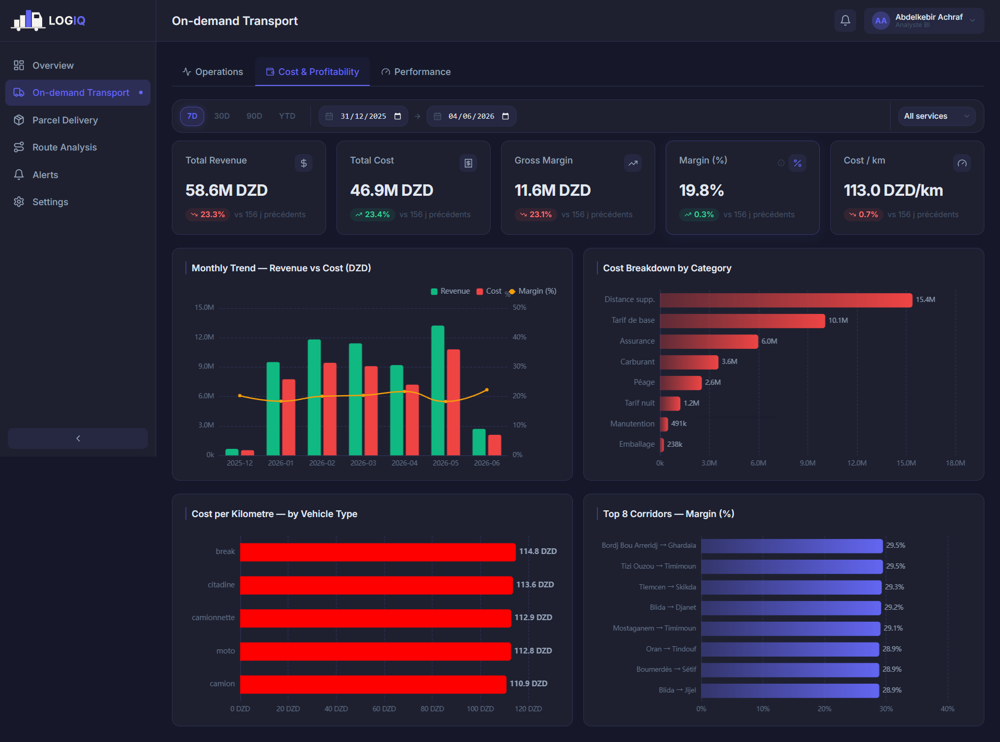{ loading=lazy }

=== "Transport · Performance"

    | KPI | Formula (pseudo) | Business value |
    |---|---|---|
    | On-time rate % | on-time / rated × 100 | Punctuality (alert below 80 %) |
    | Avg duration (h) | AVG(duration) / 60 | Trip duration |
    | Avg client rating | AVG(rating), out of 5 | Experience (below 3.5 = degraded) |
    | Avg arrival delay (min) | AVG(actual − planned arrival) | Schedule adherence |
    | Night-shift rate % | night / total × 100 | Night-surcharge exposure |

    **Charts:** on-time trend (dual-axis lines) · delay distribution (bar) · rating distribution
    (bar) · on-time by vehicle (bar).

    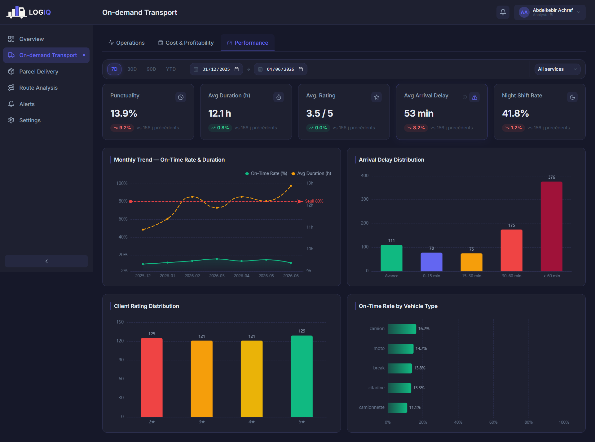{ loading=lazy }

=== "Parcel · Operations"

    | KPI | Formula (pseudo) | Business value |
    |---|---|---|
    | Parcels handled | COUNT(*) over creation date | Raw activity volume |
    | Delivered | COUNT FILTER status = Delivered | Successful deliveries |
    | Returns | COUNT FILTER status = Returned | Cost incurred without delivery revenue |
    | In transit | COUNT FILTER not terminal | Live backlog still moving |
    | Avg delivery duration | AVG(duration) / 60 FILTER Delivered | Speed of service (hours) |

    **Charts:** volume trend (stacked bar) · status breakdown (donut) · region flow (heatmap) ·
    zone distribution (bar).

    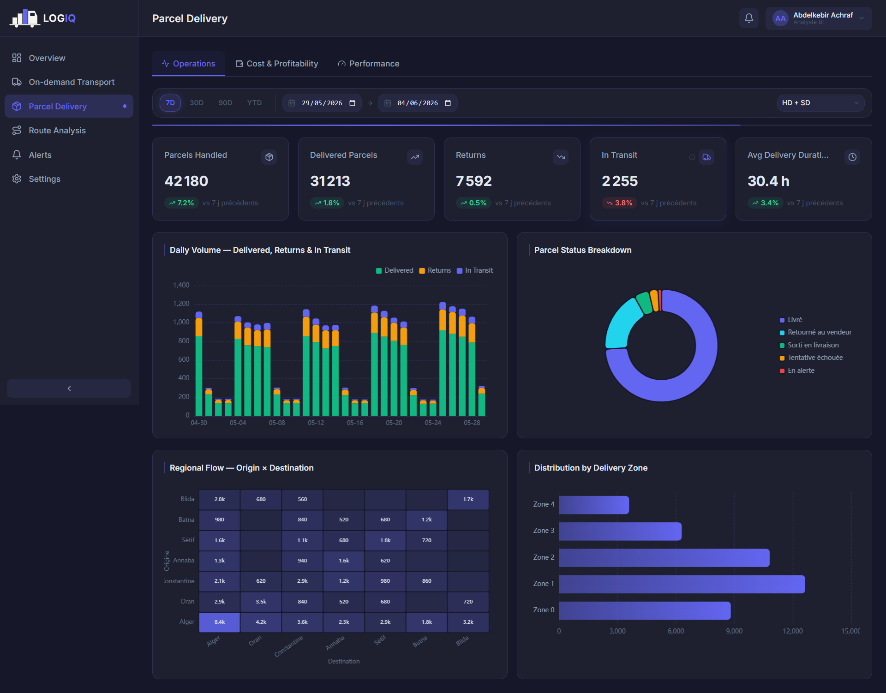{ loading=lazy }

=== "Parcel · Cost & Profitability"

    | KPI | Formula (pseudo) | Business value |
    |---|---|---|
    | Fees collected | SUM(delivery fee) | Revenue of the parcel segment |
    | Operational cost | SUM(validated charges) + SUM(salaries) | Total cost to serve |
    | Gross margin % | (fees − cost) / fees × 100 | Profitability of the axis |
    | Avg fee / parcel | fees / delivered | Average unit revenue |
    | Cost / delivered parcel | cost / delivered | Unit cost; loss-making above the fee |

    **Charts:** revenue vs cost (combo) · expenses by category (bar) · regional margin (heatmap) ·
    zone profitability (dual-axis).

    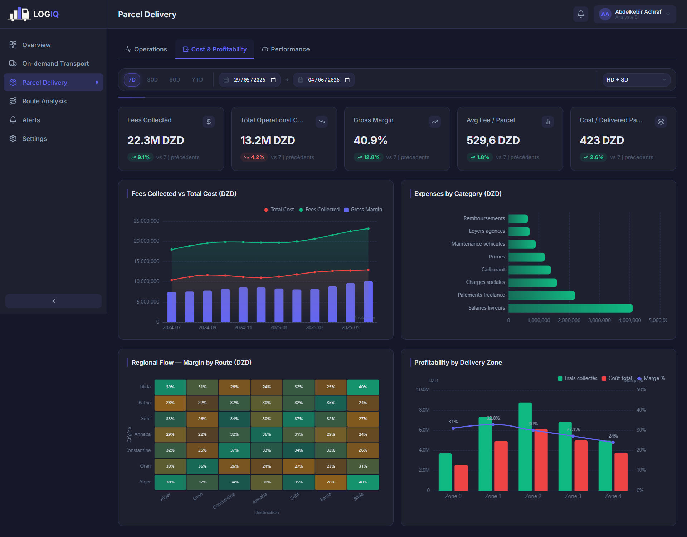{ loading=lazy }

=== "Parcel · Performance"

    | KPI | Formula (pseudo) | Business value |
    |---|---|---|
    | Delivery rate % | delivered / created × 100 | Service level (alert below 73 %) |
    | Avg attempts | AVG(attempts + 1) FILTER Delivered | Field efficiency |
    | 1st-attempt success % | first-try delivered / delivered × 100 | Right-first-time quality |
    | Avg delivery duration | AVG(duration) / 60 FILTER Delivered | Speed of service (hours) |
    | Claims declared | COUNT(reimbursements) | Packaging / handling quality signal |

    **Charts:** monthly performance (dual-axis lines) · duration distribution (histogram) · top
    expedition centres (ranked bar) · claims by type (donut).

    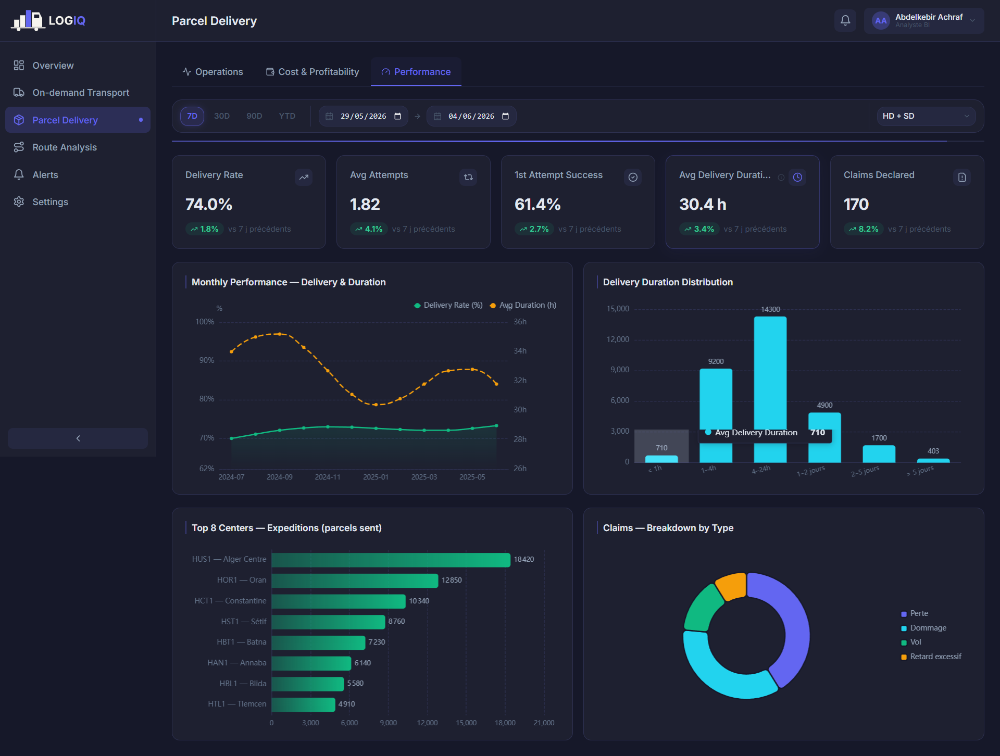{ loading=lazy }

## Visualisation toolkit

The dashboards are **visual-first**. Each KPI is a chart or graphic, with the exact figures one
click away.

| Visualisation | Library | Used for |
|---|---|---|
| KPI cards | Tremor | Headline figure, period-over-period delta, severity colour |
| Statistical charts | ECharts | Trends, comparisons, composition, scatter, heatmap, gauge, radar, Sankey |
| Custom diagrams | D3.js | Bespoke cost-flow and network visualisations |
| Interactive maps | Leaflet | Geographic distribution of flows across the wilayas |

### Verifiable KPIs

Every KPI card opens a **data-table view** that lists the individual records behind the headline
figure. Opening *Total Requests*, for example, shows each request with its identifier, date,
service, status, origin, destination, distance and stop count. Every KPI thus becomes an
**auditable** number rather than an opaque one.

<figure markdown="span">
  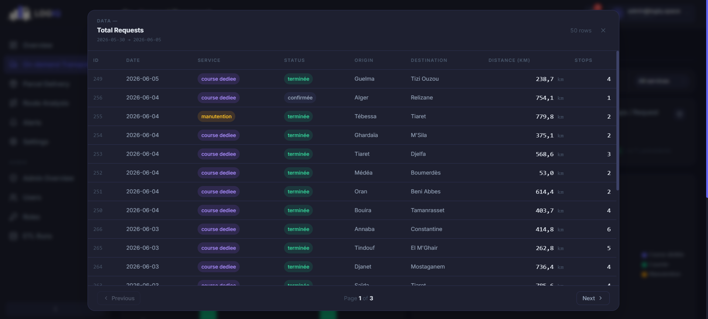{ loading=lazy }
  <figcaption>The data-table view behind the <em>Total Requests</em> card.</figcaption>
</figure>

## Proactive alerting

Presentation answers questions when they are asked. **Alerting answers them before they are
asked.** A user defines a **rule** on a sensitive indicator:
*metric · operator · threshold · severity · cooldown*.

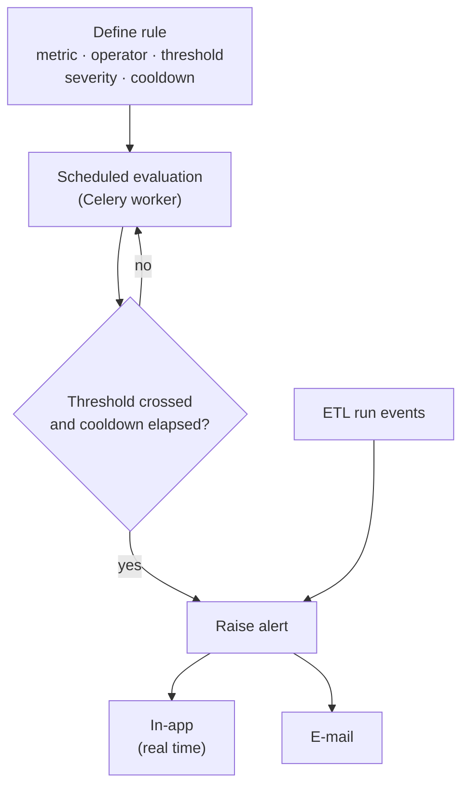

- A periodic **Celery** task reads each active rule's value from the aggregate layer. The
  **cooldown** stops a still-breached metric from alerting on every cycle.
- Alerts carry a **severity**: *info*, *warning* or *critical*.
- Delivery depends on **subscriptions** (a user only receives alerts for rules they subscribe to)
  and on each user's **channel preference** (in-app, e-mail, or both).
- **In-app** notifications are pushed in real time. **E-mail** covers ETL-run reports, and
  alerts are grouped into a **weekly digest** sent every Sunday at 07:00.

=== "Alerts page"

    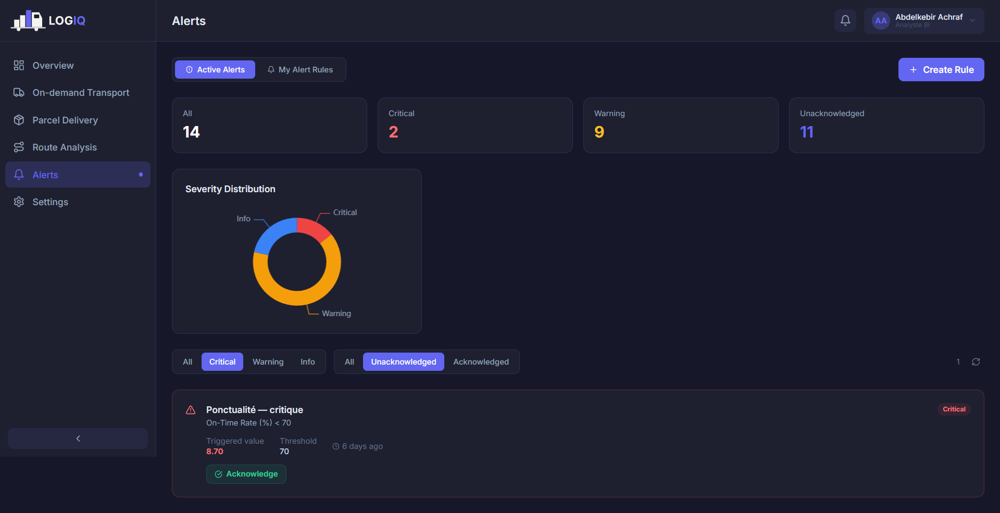{ loading=lazy }

=== "Defining a rule"

    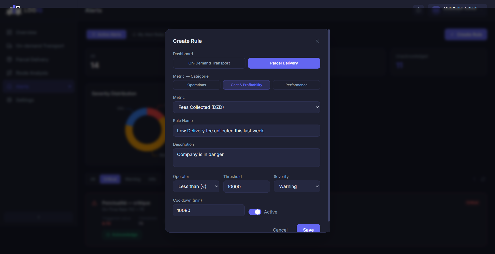{ loading=lazy }

=== "Subscriptions"

    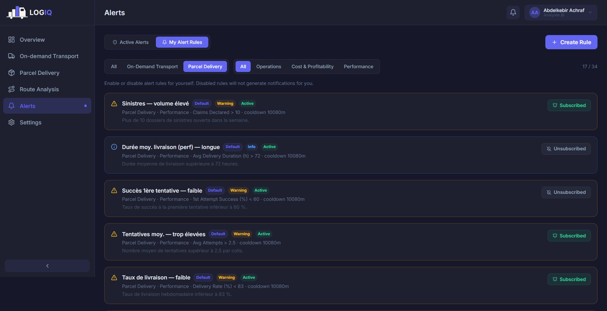{ loading=lazy }

=== "Notification centre"

    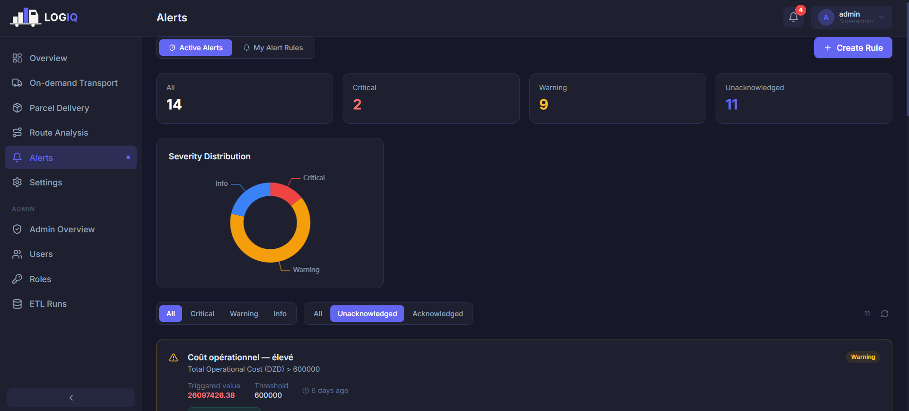{ loading=lazy }

=== "E-mails"

    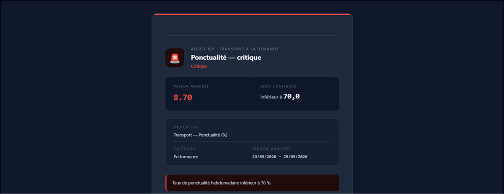{ loading=lazy }

    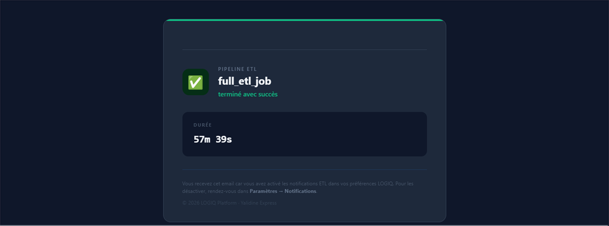{ loading=lazy }

## Preferences and multilingual support

Each user picks a **theme** (light or dark), their notification channels and the interface
**language**. LOGIQ ships in **Arabic, French and English**, with a complete right-to-left layout
for Arabic. Preferences are stored on the operational database and re-applied at every session.

=== "Preferences (Arabic)"

    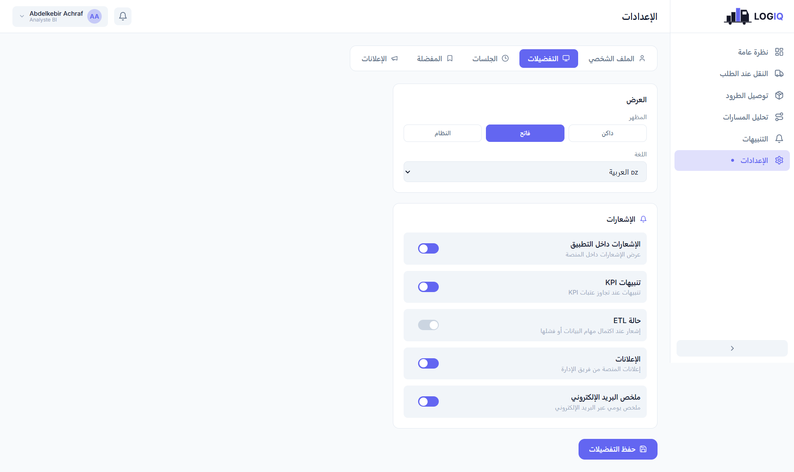{ loading=lazy }

=== "Dashboard (Arabic, RTL)"

    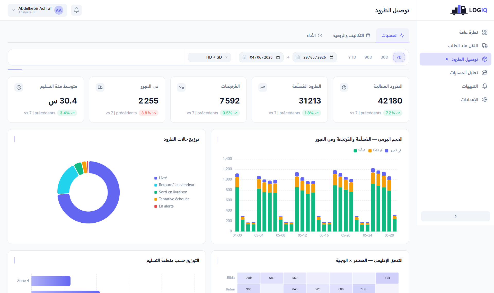{ loading=lazy }

## Administration

Administrators keep full access to every business page. They also have an **Administration**
area: a platform overview, the **Users** page (activate HR-imported accounts and assign roles),
the **Roles** page (define what each role may reach), and the **ETL Runs** history.

The backend also exposes a **webhook receiver** for the HR system. When an employee is hired,
leaves or has their details changed, the matching account is provisioned, revoked or updated
automatically.

=== "Admin overview"

    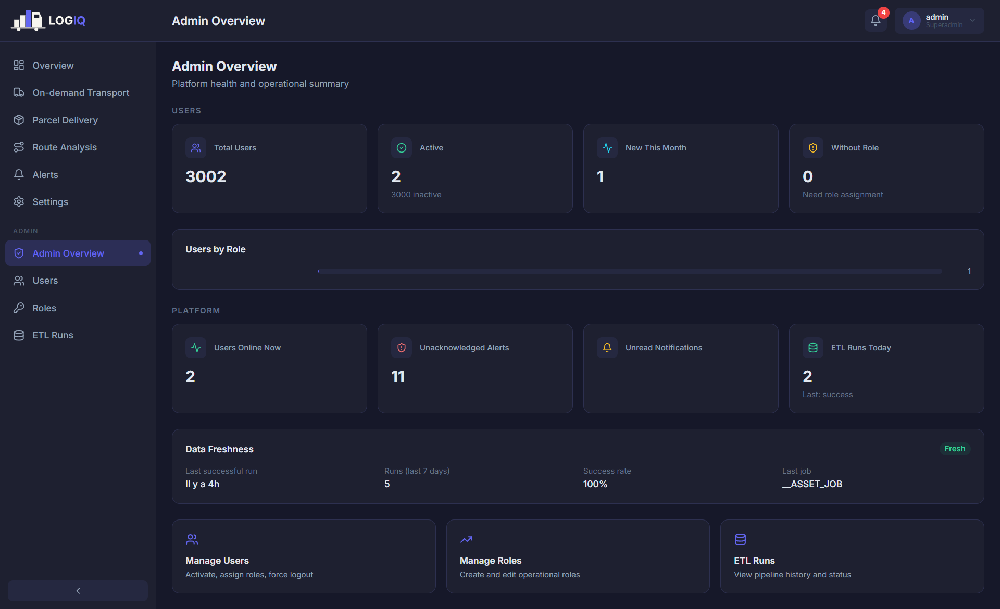{ loading=lazy }

=== "Roles"

    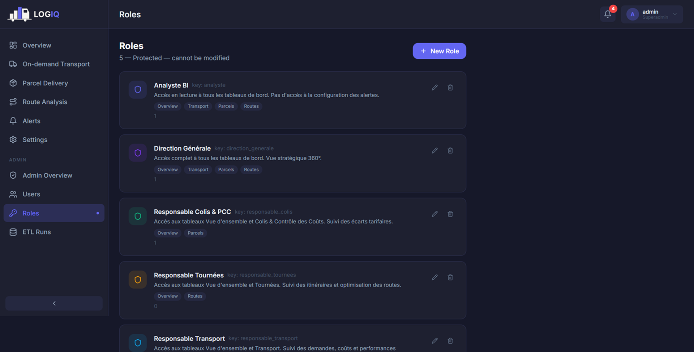{ loading=lazy }

## Graceful degradation

The analytical and operational planes are separate, so a brief outage of the warehouse does not
break the experience. The analytics endpoints **fail safe**: they return representative figures
instead of an error, and the interface stays usable for real work and for demonstrations alike.
