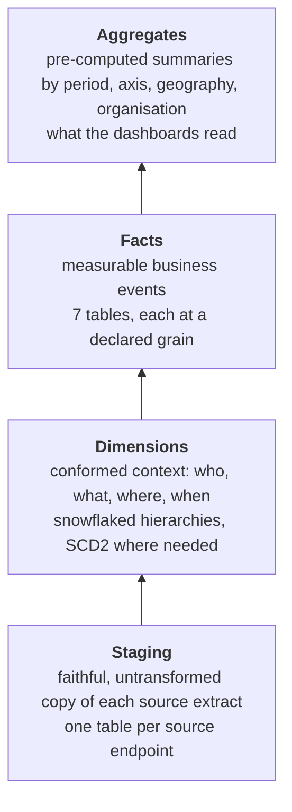
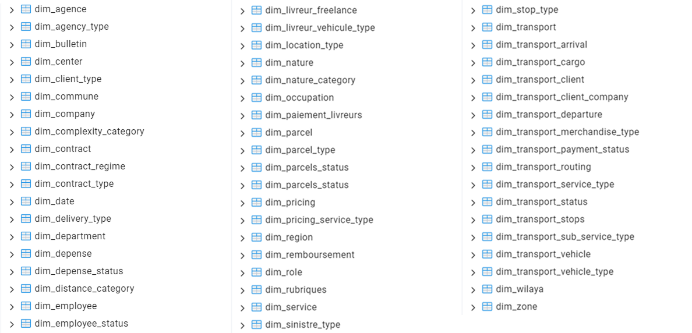
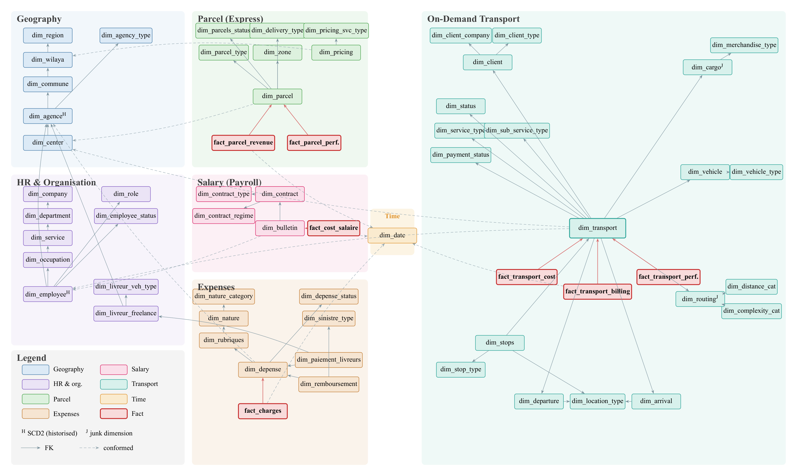
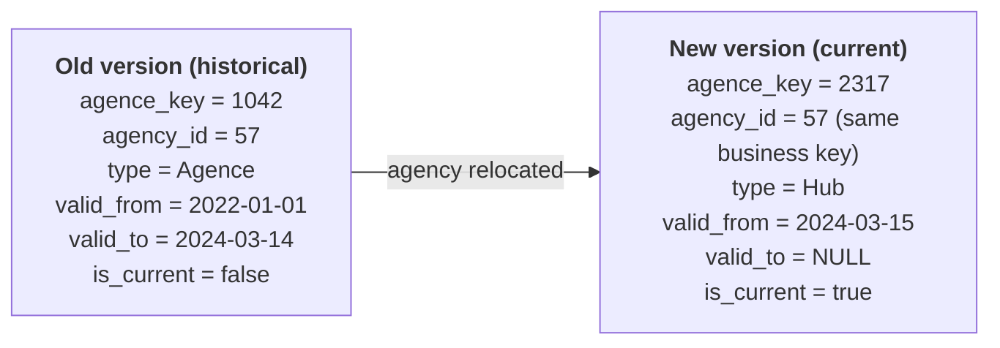
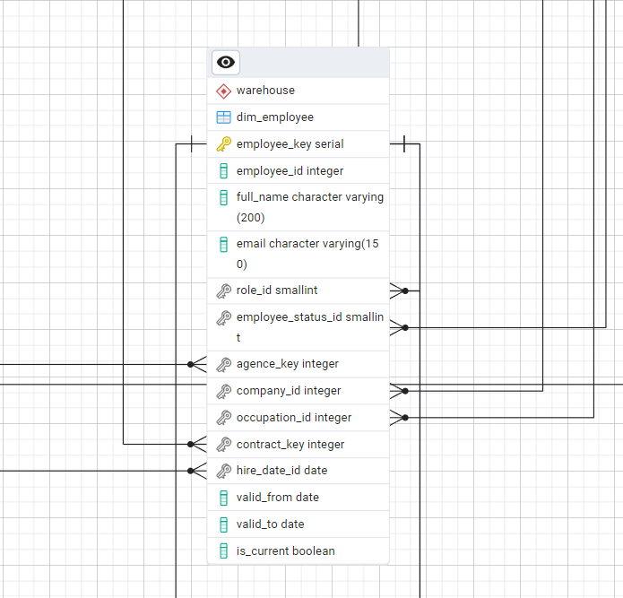

# Data warehouse

The data warehouse is the analytical core of LOGIQ. It is the single consolidated base that every
dashboard, alert and AI-assistant answer reads from.

## Design approach

The warehouse uses **dimensional modelling** following the Kimball lifecycle. The model is
organised around the business questions to answer, not around the source systems. For each
business process (parcel delivery, transport request, salary run, expense record), four steps
are applied in order:

1. **Select the business process.**
2. **Declare the grain** — the exact meaning of one fact row, fixed before any column.
3. **Choose the dimensions** — the descriptive context: who, what, where, when.
4. **Identify the facts** — the numeric measures recorded at that grain.

## Source scoping

Of the ten operational applications, **five feed the warehouse**. Each source is sorted into
**facts** (measurable events) and **dimensions** (descriptive context).

| Source (generic name) | Data it provides | Feeds |
|---|---|---|
| Core logistics application | Geography (wilayas, communes), delivery-centre network, pricing grid, parcel status-event history | Geography, pricing and parcel dimensions; the 2 parcel facts |
| HR system | Companies, agencies, organisational hierarchy, employees, roles | Organisational and HR dimensions (incl. SCD2 agencies and employees) |
| Expense management system | Operating expenses, freelance-driver payments, parcel reimbursements | Expense dimensions; the charges fact |
| Payroll system | Payslips and employment contracts | Contract and payslip dimensions; the salary-cost fact |
| Dedicated transport module | B2B requests and their stops | Transport dimensions; the 3 transport facts |

Two points drive the rest of the design. First, the **parcel status-event history is by far the
largest input**, and the only one at a fine, repeated grain (many events per parcel). Second, the
**HR system is shared by both axes** — exactly what conformed dimensions exploit.

## Four layers

Each layer refines the one below it. Most importantly, the dashboards read the **aggregate
layer**, not the raw facts. That is what keeps a view responsive at national scale.

| Layer | Realised in PostgreSQL as | Objects |
|---|---|---:|
| Staging | One raw landing table per source endpoint, no business logic | 18 |
| Dimensions | Normalised (snowflaked) tables, SCD Type 2 where attributes change | 55 |
| Facts | Fact tables keyed to their dimensions, holding the measures | 7 |
| Aggregates | **Materialised views**, refreshed each run — the only source of the analytics API | 5 |

The schema is created by ordered, **idempotent** SQL scripts, one group per layer. The whole
warehouse can therefore be rebuilt deterministically from scratch.

## Table inventory

=== "Staging (18)"

    | Source | # | Staged entities |
    |---|---:|---|
    | Core logistics application | 5 | wilayas, communes, delivery centres, pricing grid, parcel status history |
    | HR system | 4 | companies, agencies, occupations, users |
    | Expense management system | 6 | expense natures, expense headings, expenses, driver payments, reimbursements, transfers |
    | Payroll system | 1 | payslips |
    | Dedicated transport module | 2 | requests, stops |

=== "Dimensions (55)"

    | Domain | # | Principal dimensions |
    |---|---:|---|
    | Geographic | 6 | region → wilaya → commune → agency (SCD2) → centre; agency type |
    | HR & organisational | 9 | company → department → service → occupation; employee (SCD2); freelance driver; role; status |
    | Time | 1 | date (calendar spine, 2022–2026) |
    | Parcel (express) | 7 | parcel; pricing; status; zone; delivery and parcel type |
    | Salary | 4 | contract; payslip; contract type and regime |
    | Expenses | 8 | expense; nature hierarchy; reimbursement; driver payment; status; claim type |
    | Transport | 20 | transport (central); departure / arrival (role-playing); cargo and routing (junk); vehicle; client; stops; status; service type |

    <figure markdown="span">
      { loading=lazy .on-white }
      <figcaption>The dimension tables as they exist in PostgreSQL.</figcaption>
    </figure>

=== "Facts (7)"

    | Fact table | Grain (one row per…) | Principal measures |
    |---|---|---|
    | **Express parcel-delivery perimeter** | | |
    | Parcel revenue | resolved parcel | Delivery fee; theoretical tariff; tariff gap |
    | Parcel performance | resolved parcel | Event count; total transit duration; failed-attempt count |
    | Salary cost | payslip (employee × month) | Gross salary; deductions; employer charges |
    | Operating charges | validated expense record | Expense amount |
    | **On-demand transport perimeter** | | |
    | Transport cost | transport request | Cost build-up (base, distance, handling, insurance, fuel…) and total cost |
    | Transport billing | transport request | Amount invoiced; amount paid; gross margin (value and %) |
    | Transport performance | transport request | Distances; durations; stop counts; delays; on-time flag; client rating |

## Schema: a fact constellation

LOGIQ adopts a **fact-constellation (galaxy)** schema with **snowflaked** dimensions.

- **Constellation:** the seven facts *share* a common set of conformed dimensions instead of
  forming isolated stars. Figures therefore reconcile: a cost and a revenue for the same agency
  and month really do refer to the same agency and month. No fact mixes a parcel measure with a
  transport measure.
- **Snowflake:** every hierarchy is normalised into one table per level, so each attribute lives
  in exactly one place. A value stored once cannot disagree with itself.

<figure markdown="span">
  [{ loading=lazy .on-white }](assets/dw-constellation-erd.png)
  <figcaption>The complete constellation: 7 facts (red) and 55 dimensions, colour-coded by subject
  area around the conformed dimensions. H = SCD2 (historised), J = junk
  dimension. Click to enlarge.</figcaption>
</figure>

## Modelling techniques

| Technique | Where | Why |
|---|---|---|
| Conformed dimensions | Time, geography, organisation, employee — shared by all 7 facts | One agreed definition, so figures reconcile across views and axes |
| Snowflaked hierarchies | Geographic and organisational chains | Each attribute stored once — a single source of truth |
| SCD Type 2 | Agencies and employees | A fact stays attributed to the agency or employee *as it was* at event time |
| Junk dimensions | Transport cargo and routing flags | Many low-cardinality flags collapsed into one row; narrow facts |
| Role-playing dimensions | Geography as departure vs arrival; calendar as creation / completion / payment date | One physical table reused in several roles |
| Natural vs surrogate keys | Natural keys where codes are stable (wilaya, commune, date); surrogates for SCD2 and composite keys | Stability where it exists, generated keys only where needed |
| Controlled denormalisation | Hire date and company copied onto the employee dimension | Avoid nullable or SCD2-unstable join paths |
| Two financial perimeters | Express facts vs transport facts | Costs and revenues of the two axes never mixed in a fact |

### SCD Type 2 in practice

Agencies get relocated or reclassified, and employees get reassigned. The warehouse must remember
**what was true when an event happened**. A change therefore does not overwrite the row: it
closes the old version and opens a new one, each with its own surrogate key and validity window.

A fact references the version that was current at its event date, so history is preserved
exactly. All other dimensions are Type 1 (overwrite).

<figure markdown="span">
  { loading=lazy width="420" }
  <figcaption>The employee dimension: surrogate key, validity window and <code>is_current</code> flag.</figcaption>
</figure>

## Scale

The warehouse is sized for **production-scale volumes**. The parcel status-event history
dominates, at tens of millions of rows. The cost side (payslips, expenses) is smaller, and the
transport facts are modest. This scale explains three design choices:

- the **aggregate layer** lets a dashboard read a small summary instead of scanning the facts;
- the refresh is **incremental**: only new and changed rows are loaded, never a full reload;
- the **analytical store is separate** from the operational one, so analytics never disturb
  the application.

Measured volumes of the test dataset are on [Testing & results](testing-results.md#scale-of-the-test-dataset).
