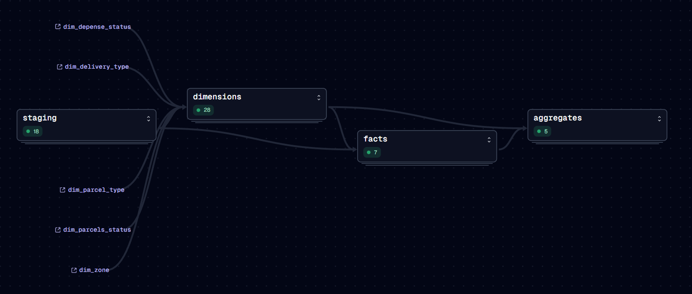
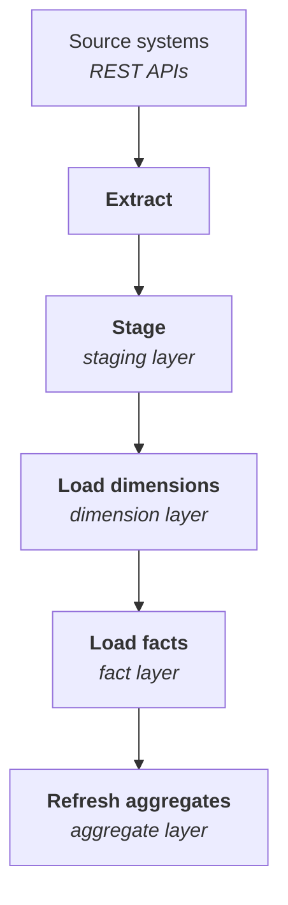
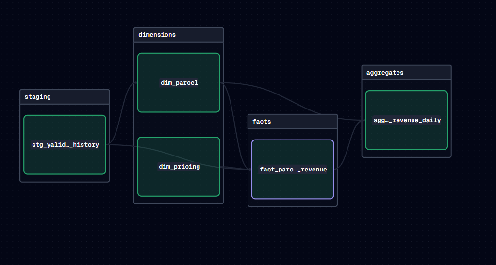
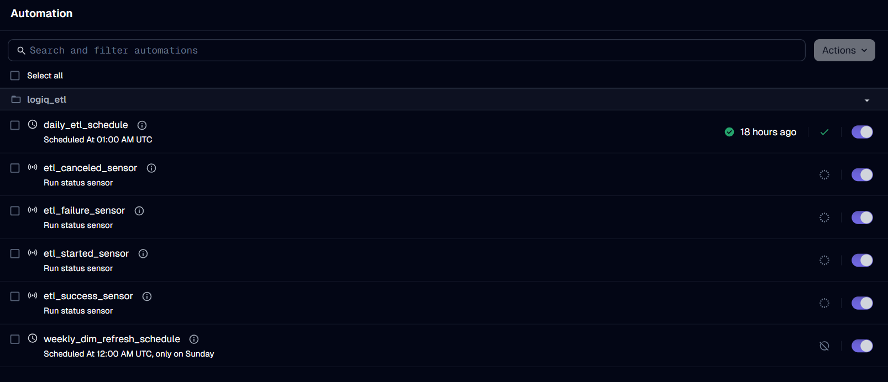
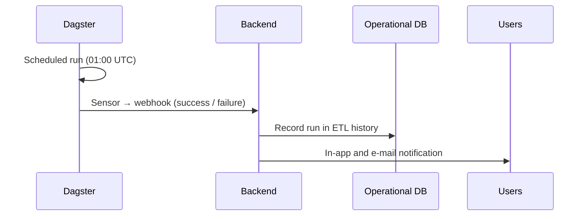
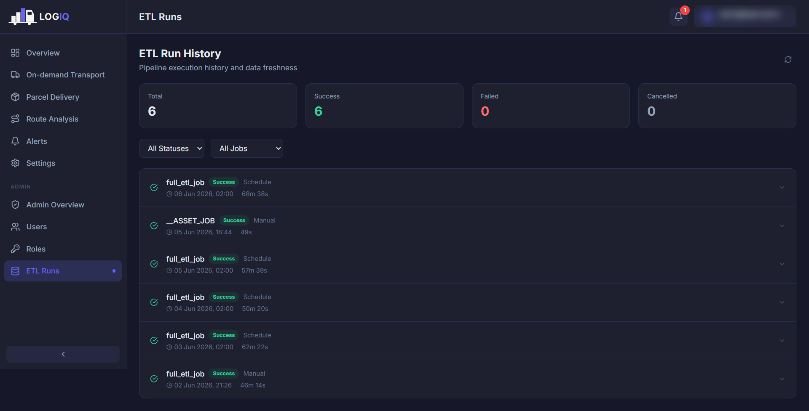

# ETL pipeline

Nothing reaches the warehouse by hand. An **Extract-Transform-Load** pipeline draws data from each
source, reshapes it into the dimensional model and keeps it current, with no manual intervention.

## An asset-oriented pipeline

The pipeline is not a linear script of imperative steps ("run this, then that"). It is designed
around the **data assets** it produces. Each warehouse table is an *asset* that declares the
assets it derives from: a fact declares its dimensions, an aggregate declares its facts. From
these declarations, the orchestrator (**Dagster**) reconstructs the lineage of the whole warehouse.

!!! success "What this buys"
    - **Correct ordering by construction** — assets are built in dependency order automatically;
      nothing is hand-wired.
    - **Safe partial re-runs** — any single asset, or sub-graph, can be rebuilt without
      reprocessing everything.
    - **Transparency** — the dependency graph is itself a readable, auditable map of the
      warehouse.

<figure markdown="span">
  { loading=lazy }
  <figcaption>The warehouse pipeline as a Dagster asset graph: 18 staging assets, dimensions, 7 facts and 5 aggregates.</figcaption>
</figure>

## Five stages

The pipeline advances data through five stages, each mapped onto a warehouse layer. The
integration process and the data model therefore share one structure.

1. **Extract** — pull data from each source through its API, handling pagination and transient
   failures. Extraction depends only on the *published API contract*, never on a source's
   internal database. In total, 18 endpoints are consumed across the five source systems.
2. **Stage** — land the raw data, untransformed, in the staging layer. The rest of the pipeline
   reads staging, not the live sources.
3. **Load dimensions** — clean and standardise records, resolve natural keys to surrogate keys,
   conform the snowflaked dimensions, and version the SCD2 dimensions.
4. **Load facts** — resolve each business event against its dimension keys and compute its
   measures, so every fact lands analysis-ready.
5. **Refresh aggregates** — rebuild the materialised views that the dashboards read.

<figure markdown="span">
  { loading=lazy }
  <figcaption>One fact traced back through its staging feed and dimensions, as Dagster records its lineage.</figcaption>
</figure>

## Engineering properties

| Property | Why it matters |
|---|---|
| **Incremental extraction** | Only new and changed rows are fetched, from a high-water mark. At tens of millions of events, this is the only tractable option. Small staging tables are simply fully refreshed. |
| **Trailing re-window** (parcel status) | A parcel's status keeps changing after creation, so a pure high-water mark would miss late updates. Each run **clears and reloads the last 7 days** of status history. |
| **Idempotent loads** | Insert-or-update (upsert) keyed on the business identifier. Re-running a stage never duplicates data. |
| **Resilience** | Failed source calls are retried with exponential backoff. A stalled source is skipped rather than aborting the whole run. |
| **Scheduling** | A full refresh runs automatically every night, plus a lighter dimension refresh. |
| **Observability** | Every run emits lifecycle events (start, success, failure, cancellation). Each run is recorded, and users are notified. |
| **Source decoupling** | Because extraction depends only on the API contract, the same pipeline connects to the real production systems unchanged. |

## Scheduling and observability

Dagster launches a full materialisation **every day at 01:00 UTC** (02:00 in Algeria), so each
morning's dashboards rest on data refreshed overnight.

<figure markdown="span">
  { loading=lazy }
  <figcaption>The pipeline's automation in Dagster: the schedules and the run-status sensors.</figcaption>
</figure>

When a run finishes, a Dagster **sensor** calls a **webhook on the backend**. The backend then:

1. records the run (outcome, timing, any failure) in the **ETL run history**;
2. notifies every user who enabled ETL notifications that fresh data is available, or that a
   refresh failed.

This reuses the same notification machinery as the business alerts. A single channel therefore
carries both the data's *freshness* and the business's *drift*.

<figure markdown="span">
  { loading=lazy }
  <figcaption>The ETL run history, as administrators see it in LOGIQ (test environment).</figcaption>
</figure>
