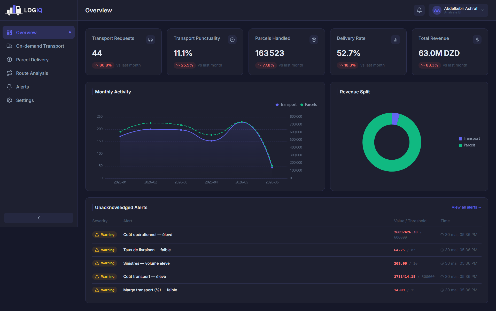

# LOGIQ { .hidden-title }

Turning scattered logistics data into reliable, proactive decisions.

**LOGIQ** (*Logistics + IQ*) is a Business Intelligence decision-support system built for
one of Algeria's leading express-delivery operators. It brings data scattered across several
operational applications into a **single data warehouse**. An **automated ETL pipeline** keeps
that warehouse current. On top of it, LOGIQ adds **interactive dashboards**, **proactive alerts**
and a **conversational AI assistant**, so that managers decide on evidence rather than intuition.

It covers two business axes — **on-demand dedicated transport** and **parcel delivery** — each read
through the same three views: **Operations**, **Cost & Profitability** and **Performance**.

<figure markdown="span">
  { loading=lazy }
  <figcaption>The consolidated Overview, the landing page after sign-in (synthetic test data).</figcaption>
</figure>

## At a glance

| | |
|---|---|
| **Business axes** | 2 — on-demand dedicated transport (*Must have*) and parcel delivery (*Should have*) |
| **Views per axis** | 3 — Operations · Cost & Profitability · Performance |
| **KPIs** | 30 — five per view, per axis, each backed by a drill-down data table |
| **Source systems integrated** | 5 operational applications, consumed through 18 REST endpoints |
| **Data warehouse** | 18 staging tables · 55 dimensions · 7 fact tables · 5 aggregate materialised views |
| **Schema** | Fact constellation with snowflaked, conformed dimensions; SCD Type 2 history |
| **Data refresh** | Automatic, daily at 01:00 UTC — incremental, idempotent and observable |
| **Test scale** | ≈ 13.0 M parcels and ≈ 30.5 M parcel-status events (synthetic, production-scale) |
| **Warehouse integrity audit** | 100 % coverage between layers, 0 violations on SCD2 and business-rule checks |
| **Access control** | 5 default roles, view-level RBAC, users provisioned from the company HR system |
| **Interface** | Arabic (right-to-left), French and English · light and dark themes |
| **Specification** | 12 functional and 19 technical specifications (ISO/IEC 25010) |
| **Stack** | Open-source data and application stack (PostgreSQL, Dagster, Django, Celery, Next.js), fully containerised |
| **Deployment** | One Docker Compose stack on a single modest VPS (2 vCPU, 8 GB RAM) |
| **Timeline** | October 2025 – June 2026 |

!!! note "About the figures on this site"
    The production systems could not be connected during the project, so the platform was validated
    against a faithful simulation of the source systems fed with **synthetic, business-realistic
    data**. Every number visible in a screenshot comes from that test dataset, not from real
    company activity.

## Explore

-   :material-office-building-outline:{ .lg .middle } **[Case study](case-study.md)**

    ---

    The organisations, the two business services, the diagnosis of the existing situation
    and the prioritised objectives.

-   :material-sitemap-outline:{ .lg .middle } **[Architecture](architecture.md)**

    ---

    Functional and technical specifications, global architecture, technology stack,
    security and deployment.

-   :material-database-outline:{ .lg .middle } **[Data warehouse](data-warehouse.md)**

    ---

    Four layers, a fact constellation of 7 facts and 55 dimensions, and the modelling
    techniques behind it.

-   :material-transit-connection-variant:{ .lg .middle } **[ETL pipeline](etl-pipeline.md)**

    ---

    An asset-oriented, incremental and idempotent pipeline orchestrated with Dagster.

-   :material-view-dashboard-outline:{ .lg .middle } **[Dashboards & alerting](dashboards-alerting.md)**

    ---

    Two axes × three views, 30 KPIs, threshold-based alerts delivered in-app and by e-mail.

-   :material-robot-outline:{ .lg .middle } **[AI assistant](ai-assistant.md)**

    ---

    Ask a question in plain language, get the figures or a chart — read-only and
    role-aware.

-   :material-check-decagram-outline:{ .lg .middle } **[Testing & results](testing-results.md)**

    ---

    Simulated sources, a data-quality gate, an end-to-end run and a warehouse-integrity
    audit.

-   :material-rocket-launch-outline:{ .lg .middle } **[Future work](future-work.md)**

    ---

    Limitations, contributions and the road ahead — starting with route analysis.

See also the [Glossary](glossary.md) for the BI and data-modelling terms used throughout.

## Credits

LOGIQ was designed and built by **Achraf Abdelkebir** as a final-year project for the State
Engineer diploma in Computer Science at the **École nationale Supérieure d'Informatique (ESI)**,
Algiers — option *Information Systems and Technologies (SIT)*, class of 2025/2026.

- **Host organisation:** Ourquilane — Algerian software company that carried the project.
- **Client:** Yalidine El Djazair Services (Yalidine Express) — express-delivery operator for
  which the platform was built.
- **Supervisors:** Mr. Mohamed Amir Abbas (ESI) and Mrs. Yasmine Rihane (Ourquilane).

!!! info "No source code here"
    This site is a project showcase. It contains no source code, credentials or real client data.
