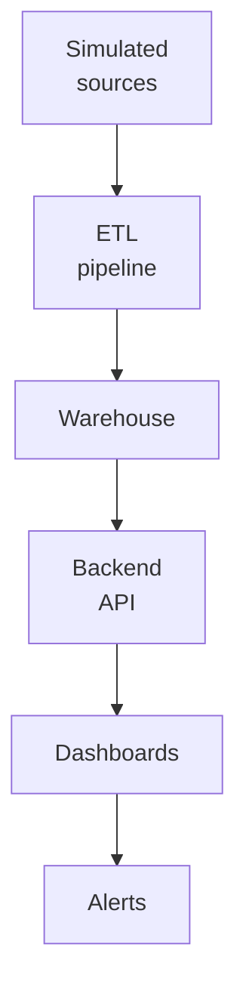
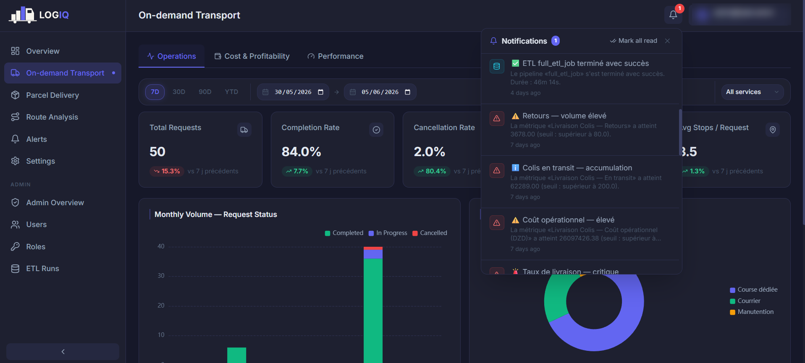
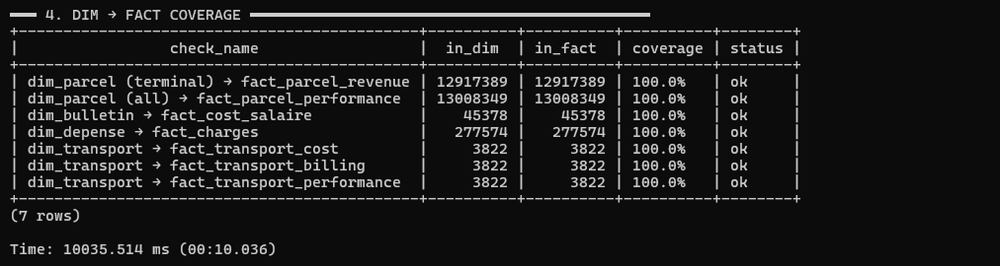
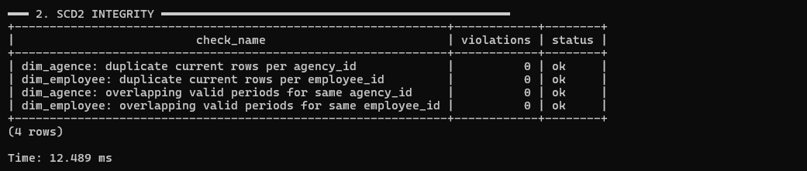

# Testing & results

A decision-support system is only as valuable as the confidence its users place in it. The
production source systems could not be connected during development, so LOGIQ was validated end to
end against a **faithful test environment**. The key property of that environment: the pipeline
connects to it **exactly as it would to the real systems**.

## Simulated source systems

A dedicated service, built with **FastAPI over PostgreSQL**, simulates the five source systems
behind REST APIs.

| Simulated system | Domain it provides |
|---|---|
| Core logistics application | Geography, delivery centres, pricing grid, full parcel-event history |
| HR system | Companies, agencies, employees, organisational hierarchy |
| Expense management system | Operating expenses, driver payments, reimbursements, internal transfers |
| Payroll system | Monthly payslips |
| Dedicated transport module | B2B transport requests and their stops |

!!! tip "Why a simulation is enough"
    Each mock API reproduces the same **endpoints, response shapes, authentication, pagination and
    quirks** as its real counterpart. The ETL depends only on that contract, never on a
    system's internal database. It therefore runs against the simulation without a single change
    to its extraction code, and the same pipeline would run unaltered against the live systems.

## Realistic data generation

The data is **synthetic but business-realistic**, and generated in two tiers:

1. **Real reference data** seeds the dimensions: the Algerian administrative geography (wilayas
   and communes), the network of agencies and delivery centres, the company structure and the
   pricing grid.
2. **Synthetic transactional data** is generated on top: parcels and their lifecycles, payroll,
   expenses and transport requests.

The synthetic data follows **domain rules**:

| Rule | What it reproduces |
|---|---|
| Working calendar | The Algerian week — Friday is the only day off; reduced weekend activity |
| Seasonality | Ramadan slowdown then pre-Eid peak, Black Friday surge, end-of-year peak |
| Geographic realism | Parcel volume spread across wilayas in realistic proportions |
| Labour-law payroll | Salaries computed with Algerian labour-law rates |
| Full parcel lifecycle | Every parcel goes through its complete multi-status lifecycle |
| Internal consistency | Costs, billing and operations reconcile with each other |

## Scale of the test dataset

The dataset is generated at **production scale**, so performance and correctness are tested under
real load. These volumes were read from the warehouse after a full run.

| Data domain | Volume generated |
|---|---|
| Parcels | **13,008,349** parcels (≈ 13 million) |
| Parcel-status events | **30,527,458** events (≈ 30.5 million) — the largest feed |
| Payroll | **45,378** monthly payslips, for a workforce growing to about 3,000 employees |
| Operating expenses | **277,574** expense records, plus 43,668 driver payments and 15,949 reimbursements |
| Dedicated transport | **3,822** B2B requests, with 13,414 stops |
| Reference dimensions | 58 wilayas, 1,541 communes, 331 agencies, 252 delivery centres |

At this scale, the aggregate layer and the incremental load are genuinely put under pressure.
On a toy dataset, neither could be meaningfully exercised.

## Data-quality gate

An automated validation suite runs **after every generation**. The dataset is admitted to the ETL
only when every critical check passes, so any anomaly seen downstream can be blamed on the
platform, not on its input.

| Check category | What it verifies |
|---|---|
| Referential integrity | Every cross-system reference points to an entity that exists |
| Financial identities | Costs, billing and reimbursements reconcile |
| Distance identities | Transport distances are coherent (leg distances sum to the total) |
| Working calendar | No operational event falls on a Friday |
| Identifier formats | Identifiers follow their expected conventions |
| Test-entity isolation | Excluded test entities never leak into the data |

The suite has two tiers. **Critical checks** block the dataset outright. **Statistical checks**
confirm that distributions are plausible (volumes by wilaya, salary ranges, lifecycle
proportions).

## End-to-end validation

The whole chain was run as one, and each stage's output was checked:

- the ETL extracts from the mock APIs and populates every warehouse layer;
- the aggregate layer feeds the backend's analytics endpoints;
- the dashboards render the resulting KPIs;
- the alerting service raises and delivers notifications when a metric crosses a threshold.

**Graceful degradation** was verified separately. With the warehouse deliberately made
unavailable, the analytics endpoints failed safe and the dashboard fell back to representative
figures instead of breaking.

<figure markdown="span">
  { loading=lazy }
  <figcaption>A populated Transport Operations page with proactive alerts and the pipeline's run notification in the notification panel.</figcaption>
</figure>

## Warehouse integrity audit

After every full run, an automated audit checks that the ETL **itself** preserved the data
through every layer.

| Audit dimension | What it verifies | Result |
|---|---|---|
| Layer population | Every staging table and principal dimension and fact holds the expected rows | All populated |
| SCD Type 2 integrity | No duplicate current rows, no overlapping validity windows | 4 checks, **0 violations** |
| Staging → dimension coverage | Every source entity reaches its dimension | 8 checks, **100 %** |
| Dimension → fact coverage | Every dimension key is exercised by its facts | 7 checks, **100 %** |
| Business rules | Financial, format and test-isolation invariants hold after load | 12 checks, **0 violations** |

Where a fact holds fewer rows than its dimension, a business rule explains it. Only parcels that
reach a billable state produce revenue rows, for example, while *every* parcel is measured for
performance.

=== "Staging → dimension"

    | Check (source entity → dimension) | In staging | In dimension | Coverage |
    |---|---:|---:|---:|
    | Parcel status history (trackings) → `dim_parcel` | 13,008,349 | 13,008,349 | 100 % |
    | HR agencies (non-test) → `dim_agence` (current) | 331 | 331 | 100 % |
    | HR users (non-test) → `dim_employee` (current) | 3,000 | 3,000 | 100 % |
    | Payslips (non-test, in range) → `dim_bulletin` | 45,378 | 45,378 | 100 % |
    | Expenses → `dim_depense` | 277,574 | 277,574 | 100 % |
    | Transport requests → `dim_transport` | 3,822 | 3,822 | 100 % |
    | Delivery centres → `dim_center` | 252 | 252 | 100 % |
    | Wilayas → `dim_wilaya` | 58 | 58 | 100 % |

=== "Dimension → fact"

    { loading=lazy }

=== "SCD2 integrity"

    { loading=lazy }

!!! success "Verdict"
    The data served by the simulated sources arrives in the warehouse **complete** (100 %
    coverage), **correct** (zero rule violations) and **consistently historised** (SCD2 intact).
    Because the pipeline connects to the simulation exactly as it would to production, this is
    evidence about the production design itself.

## Results against the objectives

| Objective | Result delivered |
|---|---|
| Consolidate the scattered data | One dimensional base; figures consistent across every view |
| Read each business axis in depth | Both axes navigable through three views, with KPI cards, charts, maps and shared filters |
| Keep the financial perimeters separate | Each axis carries its own cost and revenue perimeter |
| Monitor proactively | Threshold rules evaluated on schedule raise multi-channel alerts |
| Deliver to the right decision-maker | Role-based access gives each manager the right view, plus a consolidated overview |
| Found decisions on reliable data | Automatic, incremental, idempotent and observable refresh |

On **performance**, the design choices held up under realistic load. Because the analytics
endpoints read the pre-computed aggregate layer rather than scanning the fact tables, the
dashboards return **within seconds** even over the production-scale dataset.

!!! warning "Stated limits"
    Formal benchmark figures (dashboard response times, refresh duration) have not been measured
    yet, and no live user-acceptance round has taken place. See [Future work](future-work.md).
